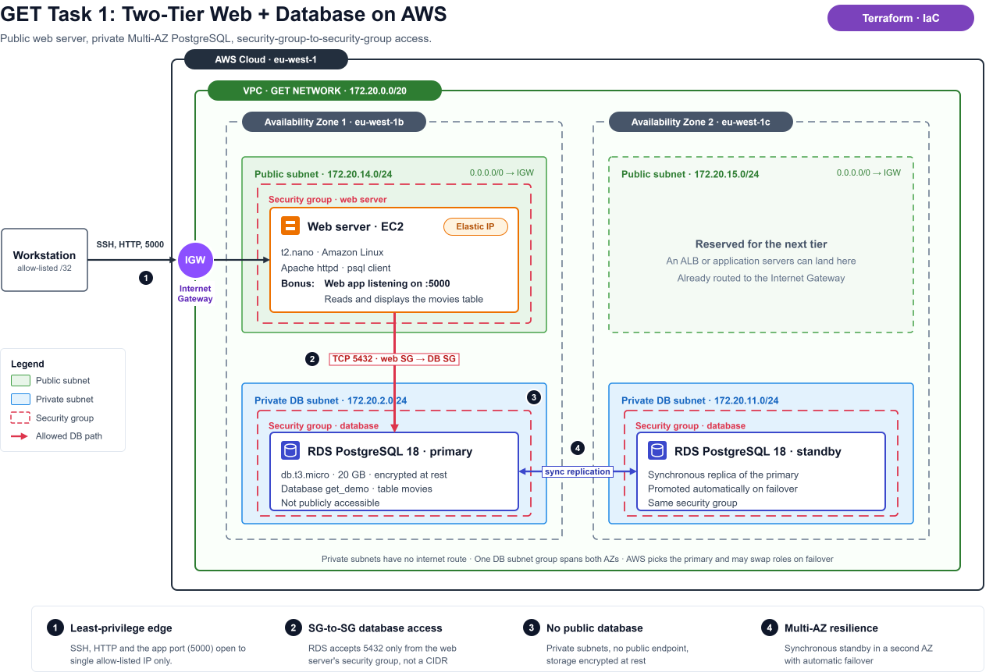
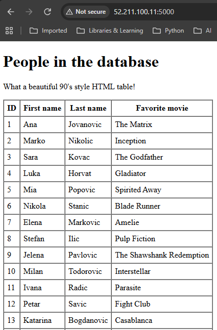

# Two-Tier Web + Database on AWS, Built with Terraform


Hello GET Management, Engineers, and anyone else looking at this project.
The requirements were simple, BUT, I am trying to impress you. Therefore, I have added some things to this project that were not asked for, but are in-line with how I work.


A public web server that reads from a private, Multi-AZ PostgreSQL database, defined entirely as code. One `terraform apply` builds the network, the security rules, the server and the database. My design is based on network isolation, least-privilege access and reusable modules. The [variables.tf](variables.tf) file is used as the main configuration file. 





## What gets built

| Layer | Resources |
|---|---|
| Network | VPC `172.20.0.0/20` in `eu-west-1`, two public and two private subnets across two AZs, Internet Gateway, route tables, Elastic IP |
| Web tier | EC2 `t2.nano` running Apache and a small web app on port 5000 that displays the `movies` table |
| Data tier | RDS PostgreSQL 18 (`db.t3.micro`), Multi-AZ, encrypted storage, not publicly accessible |
| Access control | Two security groups: the web server accepts inbound traffic only from one allow-listed IP, and the database accepts port 5432 only from the web server's security group |

## Design decisions

- **The database has no public path.** It lives in private subnets with no internet route and `publicly_accessible = false`.
- **Security groups reference each other, not IP ranges.** Only instances in the web security group can connect to the database, whatever their addresses are.
- **Multi-AZ by default.** A DB subnet group spans both AZs, so RDS keeps a synchronous standby and fails over automatically.
- **One module per concern.** `network`, `security_gr`, `ec2` and `postgres_sql` take explicit inputs and expose explicit outputs. The root module only wires them together.

## Repository layout

```text
.
├── main.tf              # Wires the modules together
├── variables.tf         # Region, CIDRs, ports, instance settings. Admin defines the environment from this file.
├── outputs.tf           # Public IP and DNS, DB endpoint, security group names
└── modules/
    ├── network/         # VPC, subnets, IGW, routes, Elastic IP, DB subnet group
    ├── security_gr/     # Web and database security groups
    ├── ec2/             # Web server instance
    └── postgres_sql/    # RDS PostgreSQL instance
```

## Deploy
Ensure that you enter your IP into the "INBOUNT_USER_IP_1" located in [variables](/variables.tf) file.
From PowerShell, with AWS credentials configured:

```powershell
# Keep secrets out of the repo: pass the DB password through the environment
$env:TF_VAR_DB_NOT_IMPORTANT = "<strong-password>"

terraform init
terraform apply
```

When it finishes, Terraform outputs the web server's public IP, database endpoint, and networking information for your convenience.

## Set up Database and Webserver
The database is private, so the table is created from the EC2 Web Server:

```powershell
ssh -i <path-to-key>.pem ec2-user@<web_server_public_ip>
```
Accept the key then move to step 2 from a new terminal.
Copy local files to the EC2 Web Server.

```powershell
scp -i <path-to-key>.pem .\website\* .\extras\* .\database\* ec2-user@<web_server_public_ip>:~/
```

On the EC2 Web Server:
```bash
chmod +x app.py setup.sh
```

Update the RDSHOST and DB_PASSWORD variables in the setup.sh file.

Sets up the local variables:
```bash
source setup.sh --var
```

Sets up the local database connection file.
```bash
./setup.sh --dbsec
```

Sets up the database and uploads the test data.
```bash
./setup.sh --dbcreate
```

The SQL table is created with the field parameter outlined below:
```sql
CREATE TABLE movies (
    id             INTEGER GENERATED ALWAYS AS IDENTITY PRIMARY KEY,
    first_name     VARCHAR(50)  NOT NULL,
    last_name      VARCHAR(50)  NOT NULL,
    favorite_movie VARCHAR(100) NOT NULL
);
```
Install the python pip dependencies via the requirements.txt file.
```bash
pip3 install -r requirements.txt
```

Run the website.
```bash
python3 app.py
```

Confirm the website is running on http://<web.server.IP>:5000

Run the database monitoring script:
```bash
./setup.sh --db-ping
```

## RDS Database Failover Test
What phrase makes your blood run cold at 3 in the morning?
"The Database crashed!"
To avoid database related hear-attacks, we set up a Database backup AND automatic failover.

The commands for the Database failover tests are executed on your local terminal.
To show the current status of the active database run:
```bash
./db_test.ps1 db-status
```

To perform a failover run:
```bash
./db_test.ps1 db-reboot
```

## Clean up

```powershell
terraform destroy
```

A Multi-AZ RDS instance and an Elastic IP bill by the hour, so tear the lab down when you are done.

## Next steps if this was client facing
- Move Terraform state to S3 with locking
- Replace the password variable with AWS Secrets Manager
- Put an Application Load Balancer in front of an app tier (the second public subnet is reserved for it)
- Deploy the web app automatically instead of by hand.
